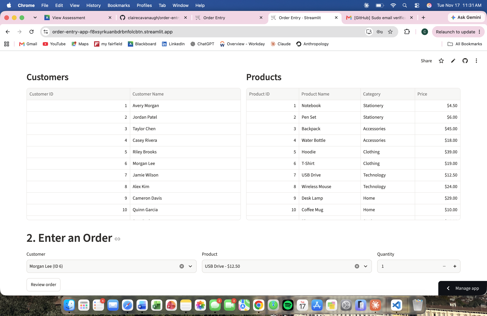
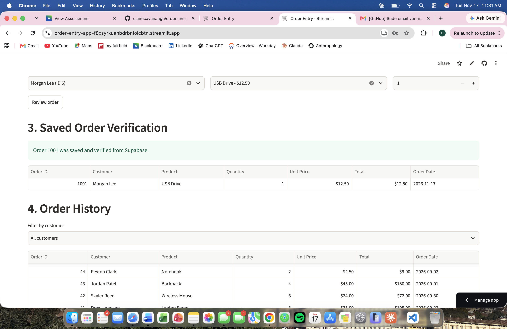

# Streamlit Order Entry App

DATA 4000 — Python with AI · Fairfield University

A Streamlit web app connected to a Supabase database. Users pick a customer and a product, enter a quantity, review and confirm the order, and save it. Every saved order is read back from Supabase to verify it.

**Live app:** (https://order-entry-app-f8xsyrkuanbdrbnfolcbtn.streamlit.app)

> Access is restricted by a password gate. Access instructions were provided privately through the course submission system.

---

## Features

| Requirement | How the app meets it |
|---|---|
| Display data | Customer and product tables loaded from Supabase through the API; prices formatted as currency; **Refresh Data** button clears the cache and reloads |
| Order entry | Customer and product dropdowns show names (IDs are kept internally); integer quantity input; review table shows customer, product, quantity, unit price, total |
| Confirmation | Checkbox confirmation is required; **Submit order** stays disabled until it is checked |
| Validation | Customer and product required and re-checked in the database; quantity must be a positive whole number (widget limits plus server-side `validate_quantity`) |
| Current price | The product's price is fetched from Supabase at review time and again at submission. If it changed, the new price is shown and confirmation is required again |
| Saving | `order_date` = current date (America/New_York); `order_id` is generated by the database; success message shown only after the insert succeeds |
| No duplicate orders | Each review has a unique token. Inserts only run inside the Submit button branch, the token is marked as submitted, and the review is cleared after saving |
| Verification | The generated `order_id` is used in a **new** API query; the saved row is shown with Order ID, Customer, Product, Quantity, Unit Price, Total (from stored `unit_price`) and Order Date |
| Order history | Loaded from Supabase; refreshed after each successful order and on Refresh Data |
| Extra credit | Customer filter on Order History with the total value of that customer's orders |
| Errors | Database and connection errors show a friendly message with no credentials. If the save succeeds but verification fails, the app says so and does not resubmit |
| Access control | Server-side password gate (`APP_PASSWORD` in secrets) runs before any database access |

## Project files

| File | Purpose |
|---|---|
| `app.py` | Streamlit interface |
| `database.py` | All Supabase API calls, validation and price helpers |
| `config.py` | Reads credentials from Streamlit secrets or environment variables |
| `requirements.txt` | Packages required to run the app |
| `.gitignore` | Excludes `.env`, `.streamlit/secrets.toml` and other local files |
| `.env.example` | Example environment file (placeholder values only) |
| `.streamlit/secrets.toml.example` | Example Streamlit secrets file (placeholder values only) |

## Database tables

| Table | Columns used |
|---|---|
| `customers` | `customer_id`, name column(s) (`customer_name`, `name`, `full_name`, or `first_name` + `last_name`) |
| `products` | `product_id`, `product_name`, `category`, `price` |
| `orders` | `order_id` (auto-generated), `customer_id`, `product_id`, `quantity`, `unit_price`, `order_date` |

## Run locally

```bash
git clone https://github.com/YOUR-USERNAME/YOUR-REPO.git
cd YOUR-REPO
python -m venv .venv
source .venv/bin/activate          # Windows: .venv\Scripts\activate
pip install -r requirements.txt
cp .env.example .env               # then fill in your real values
streamlit run app.py
```

## Deploy to Streamlit Community Cloud

1. Push the repository to GitHub. Confirm `.env` and `.streamlit/secrets.toml` are **not** in the repo.
2. Go to [share.streamlit.io](https://share.streamlit.io) and sign in with GitHub.
3. Click **Create app** and choose this repository, branch `main`, and main file `app.py`.
4. Open **Advanced settings → Secrets** and paste:
   ```toml
   SUPABASE_URL = "https://your-project-ref.supabase.co"
   SUPABASE_KEY = "your-supabase-secret-key"
   APP_PASSWORD = "your-classroom-password"
   ```
5. Click **Deploy**, then run the tests below on the deployed URL.

## Testing results (deployed app)

Tested on: 11/17/2026 at https://YOUR-APP-NAME.streamlit.app

| Test | Expected result | Actual result | Pass? |
|---|---|---|---|
| Open the deployed app | Interface loads after authorized access | | PASS|
| View customers and products | Records are retrieved from Supabase | | PASS|
| Try an invalid quantity (0, -1, 2.5) | Input is prevented or rejected | | PASS|
| Submit without confirmation | No order is inserted | | PASS|
| Confirm and submit a valid order | Exactly one order is inserted | |PASS |
| View the verification table | Newly saved order is retrieved from Supabase | | PASS|
| Refresh or interact with another widget | Previously submitted order is not inserted again | | PASS|
| Refresh order history | Saved order remains visible | |PASS |
| Extra credit: filter history by customer | Only that customer's orders and their total are shown | |PASS|

### Screenshots




## Libraries and techniques beyond class material

- **`st.session_state`**: stores the pending review, the submitted-review tokens and the last result across Streamlit reruns. https://docs.streamlit.io/develop/api-reference/caching-and-state/st.session_state
- **`st.cache_data` / `st.cache_resource`**: cache Supabase results and the client; `.clear()` powers the Refresh Data button. https://docs.streamlit.io/develop/concepts/architecture/caching
- **`st.column_config.NumberColumn`**: currency formatting in tables. https://docs.streamlit.io/develop/api-reference/data/st.column_config
- **`hmac.compare_digest`**: constant-time password comparison for the access gate. https://docs.python.org/3/library/hmac.html
- **`decimal.Decimal`**: exact money math (avoids floating-point rounding errors). https://docs.python.org/3/library/decimal.html
- **`uuid.uuid4`**: unique token per review so one review can only be submitted once. https://docs.python.org/3/library/uuid.html
- **`zoneinfo`**: uses Eastern time for the order date, since Streamlit Cloud servers run on UTC. https://docs.python.org/3/library/zoneinfo.html
- Streamlit's **`AppTest`** framework was used to test the review, confirmation and duplicate-prevention logic against a mock database before deployment.
